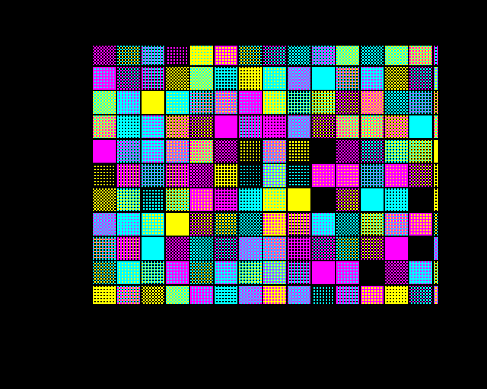

# elkgame

A large, smoothly scrolling playfield for the **Acorn Electron**, in 6502 assembler: a
**228 × 170-pixel MODE 1 window** (57 characters × 170 scanlines) that scrolls in
both directions at **50 frames a second**, a character (4 pixels) at a time across
and two scanlines at a time down, on an Electron with **one bank of sideways RAM**.
The Electron has no hardware scrolling finer than a character row and no raster
interrupts; everything here is done by timing writes to the ULA to the microsecond,
with interrupts off.

It is the start of an Electron counterpart to
[beebgame](https://github.com/ebenupton/beebgame), the BBC Micro game engine: today it
is the display engine and a test pattern -- a hash of 16 × 16-pixel blocks in the 35
dithered colours of a black-cyan-magenta-yellow palette, each with a black grid line
along its left and bottom edges, so that a misplaced line or character breaks the grid
at once -- driven by a demo script, a random walk or the keys.



## Running it

`make` builds `build/elkscroll.ssd` and `build/elkscroll.uef`.

- **Disc** (`.ssd`, boot option 3): SHIFT+BREAK on an Electron with a DFS -- a Plus 3
  with a DFS ROM, an ElkSD with MMFS, a Gotek, ...
- **Tape** (`.uef`): `*RUN` (or `CHAIN""`) and press PLAY.

It needs **32K of main RAM and one bank of sideways RAM** in any socket the loader can
page (it probes slots 0-7 and 12-15 and leaves ROM images alone).  No OS calls are
made after loading; BREAK leaves it.

| Key | |
|---|---|
| SPACE | start and stop the motion (the script, or the random walk in a `TRAJ=1` build) |
| cursor keys, or Z X : / | one step a press: a column across, two scanlines down |
| full stop | the real (Ferranti) ULA's lead-in schedule -- the default |
| comma | the FPGA ULA's schedule ([ElectronFpga](https://github.com/hoglet67/ElectronFpga) and its relatives) |

The two ULAs differ by half a microsecond in when their address counter steps in a
40-column mode, which moves every line of the window by a character; if the picture is
torn into vertical bars, the other schedule is the one for that machine.

**In an emulator**: stock emulators cannot show it (it depends on ULA details that
none modelled until these were found; `docs/ULA-NOTES.md`).  `emu/` builds Clock
Signal's Electron with the fixes, from [a fork](https://github.com/ebenupton/CLK/tree/elk-headless),
as `elkview` (a window) and `elkh` (headless, for the tests):

```sh
git submodule update --init      # emu/clk: the CLK fork
make emu                         # build-emu/elkh, build-emu/elkview (needs cmake, SDL2 for the viewer)
make run                         # the demo in elkview, real-ULA model
```

The emulator needs the Electron's ROM images, which are not included: `os.rom` (the
Electron MOS 1.00) and `basic.rom` (BASIC II), in `roms/` or the directory named by
`ELK_ROMS`.

## Status

The engine was developed against Clock Signal's core corrected to match hoglet's
ElectronFpga HDL, then against measurements from probe programs run on an issue 6
Electron, which showed where the real ULA differs (the two schedules above).  It is
checked in the emulator field by field, every window pixel against the pattern, on
random trajectories and both ULA models. This build has passed 800,000 fields (its
predecessors in this repository 4.8 million); the build it was imported from passed
7.2 million, and a 55-wide sibling 31.2 million
(`docs/VERIFICATION.md`).  **This build has not yet been run on a real Electron**;
the probe discs it was derived from have.

## Building

Needs `python3`, and `ca65`/`ld65` from [cc65](https://cc65.github.io).  `make`
builds; options set the start position, the trajectory and so on (see the Makefile:
`make START_WX=100 TRAJ=1 SEED=7`).  For the emulator: cmake 3.19+, a C++20
compiler, zlib and, for `elkview`, SDL2.

```sh
make            # build/elkscroll.ssd, .uef
make emu        # the emulator harness
make test       # a short soak of both ULA models (test/soak.sh: -n fields, -r runs, -j jobs)
```

## Layout

| Path | What |
|---|---|
| `src/` | the program: `elkscroll.s` (the root, which includes the rest in layout order), `raster.s` (the raster lock and the scanline loop; the window part is generated: two gadgets and sixteen line blocks), `frame.s` (the work below the window), `strip.s` (the beam-raced strip's first rows and per-field state), `colop.s` (a column step's edge rows), `notch.s` (the vertical step), `display.s` (the next field's display parameters), `logic.s` (the trajectory), `init.s` (start-up and the first raster sync), `kbd.s` (the keyboard, in main RAM), `tables.s`, `vars.s`, `loader.s` (finds a sideways RAM bank, loads, starts); `hw.inc`, `macros.inc` (cycle-exact delays, cell writers, page asserts), `cal.inc` (the frame's calibration) |
| `cfg/` | linker configurations: the sideways RAM image, the loader |
| `tools/` | `gen.py` (generated tables and code: lead-in variants, the window's gadgets and line blocks, pattern, and the model the checks use), `swatch35.py` (the 35 dithered colours), `mkimages.py` (DFS disc and UEF tape images), `pagecheck.py` (branches that cross a page) |
| `emu/` | the emulator harness: `elkh.cpp`, `elkview.cpp`, `machine.hpp`, and the CLK fork (`emu/clk`, a submodule) |
| `test/` | `soak.sh`, `soak1.sh` (the regression test), `fingerprint.sh`, `fpcompare.py` (timing equivalence of two builds), `fpmarkers.py` (the fixed work's sections) |
| `docs/` | `DESIGN.md` (how it works), `VERIFICATION.md` (how it is checked, and what is known), `ULA-NOTES.md` (the ULA behaviour it depends on, with sources) |

**To understand the engine, read `docs/DESIGN.md`.**

## Licence

No licence has been chosen yet.
