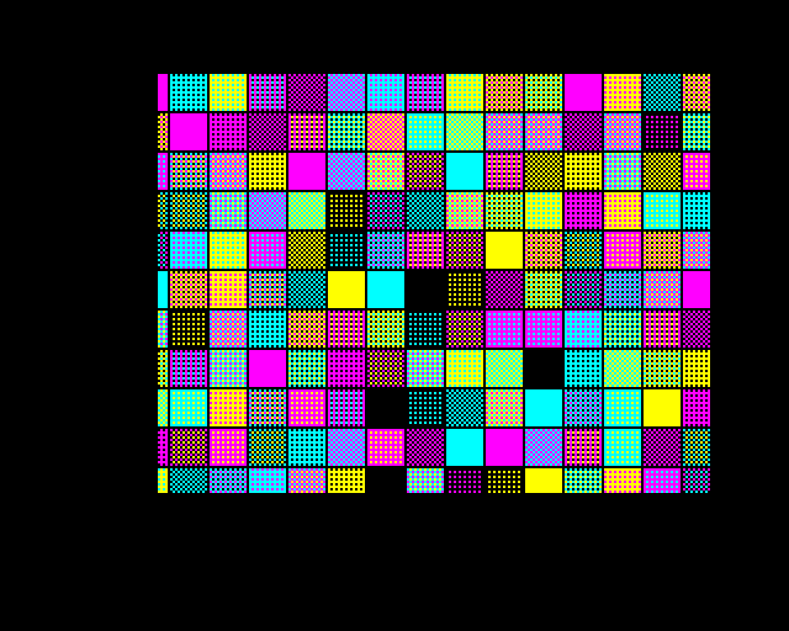
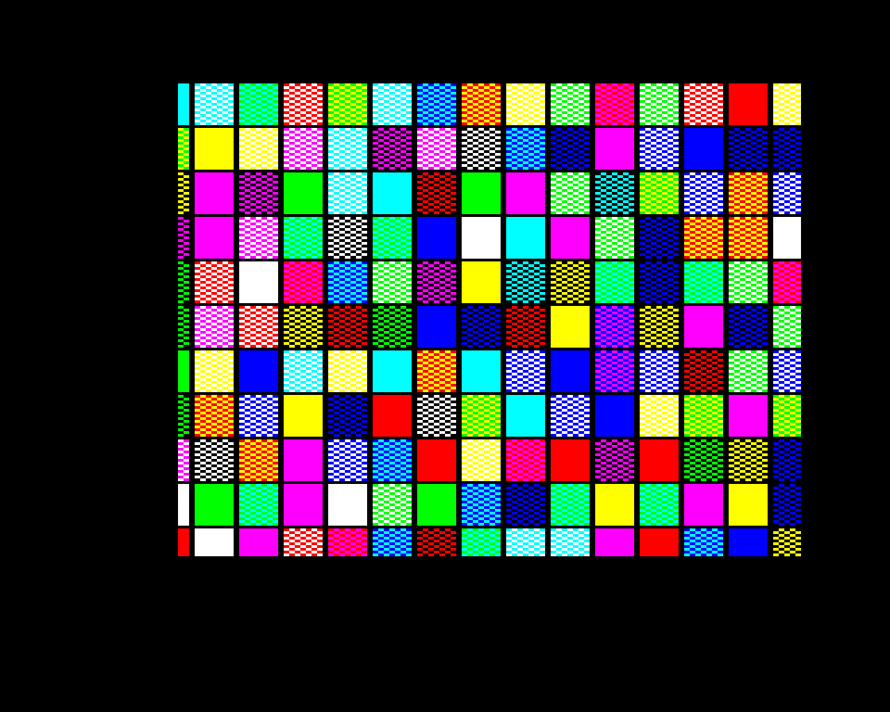

# elkgame

A scroll engine for the **Acorn Electron**, in 6502 assembler. It shows a window
**56 characters × 170 scanlines** that scrolls in both directions at **50 frames a
second**: a character at a time across and two scanlines at a time down. The window
is **224 × 170 pixels in MODE 1** (four colours) or **112 × 170 in MODE 2** (sixteen
logical colours). It needs **one bank of sideways RAM** and runs with **interrupts
off**.

The Electron has no hardware fine scroll and no raster interrupt. Everything here is
done by timing writes to the ULA to the microsecond: the screen mode changes partway
through every scanline of the window, and the program locks itself to the raster once
a field. `docs/DESIGN.md` explains how.

It is the start of an Electron counterpart to
[beebgame](https://github.com/ebenupton/beebgame), the BBC Micro game engine. Today it
is the display engine and a test card for each mode, moved by a demo script, a random
walk or the keys.

## The test cards

Each test card is a map of 2560 × 2560 characters, repeating in both directions, made
of blocks four characters wide and sixteen scanlines high. A hash of the block's
position picks its colour. Every block has a black left pixel column and a black
bottom scanline, so a misplaced line or character breaks the grid at once.

| MODE 1: the 35 dithers of black, cyan, magenta and yellow | MODE 2: the Amstrad CPC's palette as 1 × 2 dithers |
|---|---|
|  |  |

- **MODE 1.** The palette is black, cyan, magenta and yellow. A block is filled with a
  2 × 2 cell of those four inks repeated; there are 35 such cells, one for each way of
  sharing four pixels among four inks (`tools/swatch35.py`). Neighbouring blocks keep
  their shared inks in phase, so they meet without a seam. A block is 16 × 16 pixels.
- **MODE 2.** Each of the CPC's 26 non-black colours (red, green and blue each off,
  half or full) is the average of two of the Electron's eight colours: one with every
  component that is at least half on, one with every component that is full. A block
  alternates the two pixel by pixel along a line and swaps them on the next line. Each
  Electron colour is used under both of its logical names, so the card exercises every
  palette register. A block is 8 × 16 pixels.

## Running it

Prebuilt images are in `bin/`:

| | disc | tape |
|---|---|---|
| MODE 1 window | `bin/elkscroll_mode1.ssd` | `bin/elkscroll_mode1.uef` |
| MODE 2 window | `bin/elkscroll_mode2.ssd` | `bin/elkscroll_mode2.uef` |

- **Disc** (`.ssd`, boot option 3): SHIFT+BREAK on an Electron with a DFS: a Plus 3
  with a DFS ROM, an ElkSD with MMFS, a Gotek, and so on. `!BOOT` runs the program
  (`ELKSCR1` or `ELKSCR2`).
- **Tape** (`.uef`): `*RUN` (or `CHAIN""`) and press PLAY.

The program loads at &2000, finds a sideways RAM bank, copies itself there and starts.
BREAK leaves it.

**Requirements.** An Electron with one bank of sideways RAM in a slot the loader can
page: it tries slots 0–7 and 12–15 in turn, and skips any slot that holds a ROM image
or does not hold a written byte. If it finds none it says so and returns.
The program makes no OS calls once it has started.

| Key | |
|---|---|
| SPACE | start and stop the motion: the demo script, or the random walk in a `TRAJ=1` build |
| cursor keys, or Z X : / | one step a press, with the motion on or off: a column across, or two scanlines up or down |
| full stop | the real ULA's lead-in schedule (the default) |
| comma | the FPGA ULA's lead-in schedule ([ElectronFpga](https://github.com/hoglet67/ElectronFpga) and designs that share its timing) |

The two schedules differ by half a microsecond in when the ULA's address counter steps
in a 40-column mode, which moves every line of the window by a character. If the
picture is torn into vertical bars, try the other schedule.

## Hardware notes

Two properties of the real ULA constrain what the engine can show. Both are set out
in `docs/DESIGN.md`, "Known limitations and open questions".

- **The leak byte: &7E07 must be zero.** On a real ULA, a CPU write to a ULA register
  while the ULA is fetching for the display takes that video slot. The slot shows the
  RAM byte at the write's address with A15 dropped, RAM[&7E00 + the address's low
  byte], instead of its own. The engine writes the mode register (&FE07) during the
  display (the end of each lead-in, and the blip in the right margin), so those slots
  show RAM[&7E07]. &7E07 is ordinary screen memory, so the engine keeps it zero every
  field; the cost is one black byte in the picture, line 7 of whichever map cell is at
  &7E00. The ULA decodes only A0–A3 in page &FE, so in principle a game could write
  one of &FE07's mirrors (&FE17 … &FEF7) instead, whose slot shows &7E17 … &7EF7, and
  pick one whose byte is zero. That the leaked byte follows the mirror has not yet been
  tested.
- **Ferranti and Synertek ULAs differ in mode value 7.** The real-ULA schedule's
  lead-in uses the undocumented mode value 7 (&FE07 bits 3–5 = 7), which fetches like
  MODE 4. On a Synertek ULA it wraps the address at &8000 to &3000, inside the screen;
  on a Ferranti ULA it is plain MODE 4 and wraps to &5800. The longest lead-in (t = 7
  on the real schedule) crosses &8000 on the ring row that starts at &7FC0. So **on a
  Ferranti ULA, the window's character row whose ring row starts at &7FC0 is displayed
  wrongly whenever t = 7.** The engine does not avoid this yet. The emulator's
  real-ULA model has the Synertek's wrap, so it does not show the fault.

## Building

Needs `python3`, and `ca65` and `ld65` from [cc65](https://cc65.github.io).

```sh
make                    # both: build/mode1/elkscroll_mode1.ssd/.uef, build/mode2/elkscroll_mode2.ssd/.uef
make elkscroll_mode1    # one of them (or elkscroll_mode2)
make one SCRMODE=2 BUILD=build/x   # one build, in any directory
make bin                # copy the four default images into bin/
make test               # a short soak in the emulator (needs make emu and the ROMs)
```

Build options, passed as `make NAME=VALUE` (defaults in `src/init.s`):

| Option | Default | |
|---|---|---|
| `START_WX`, `START_WY` | 1283, 1280 | the map position at start (`START_WY` even) |
| `TRAJ` | 0 | 0: the demo script; 1: a random walk |
| `SEED` | &ACE1 | the random walk's seed |
| `MOTION` | 0 | 1: moving from the start (else SPACE starts it) |
| `SCHED` | 8 | the schedule at start: 8 the real ULA's, 0 the FPGA's |
| `SCRMODE` | 1 | the window's mode, 1 or 2 (read by `tools/gen.py`) |

For example `make one SCRMODE=2 BUILD=build/rw TRAJ=1 SEED=4321`.

## The emulator

Stock emulators cannot show the engine's picture: it depends on ULA details that none
of them modelled. `emu/` builds Clock Signal's Electron core from
[a fork](https://github.com/ebenupton/CLK/tree/elk-headless) (the submodule `emu/clk`)
with those details added, as two programs: `elkview`, in a window, and `elkh`,
headless, for the checks. `emu/README.md` describes both.

```sh
git submodule update --init      # emu/clk: the CLK fork
make emu                         # build-emu/elkh and build-emu/elkview
make run_mode1                   # the MODE 1 build in elkview, real-ULA model
make run_mode2                   # the MODE 2 build
```

`make emu` needs cmake 3.19 or later, a C++20 compiler and zlib; `elkview` also needs
SDL2. The emulator needs the Electron's ROM images, which are not included: `os.rom`
(MOS 1.00) and `basic.rom` (BASIC II), in `roms/` or the directory named by
`ELK_ROMS`.

The emulator does not model the leak byte or the Ferranti ULA's mode value 7 (see
Hardware notes).

## Status

The display engine is complete for the test cards. It is checked in the emulator field
by field: every window pixel against a model of the pattern, the raster lock, the
deadlines and stray stores, on random trajectories and the demo script, on both ULA
models and both window modes. The current build passed 16 runs of 20,000 fields
clean; `docs/VERIFICATION.md` has the history and the evidence for each step.

On a real Electron, the 57- and 56-wide builds before the leak-byte fix ran, and showed
the leak. The current build, with &7E07 kept zero and the single-read raster lock, has
not yet been run on hardware.

## Layout

| Path | What |
|---|---|
| `src/` | the program. `elkscroll.s` (the root, which includes the rest in layout order); `raster.s` (the raster lock, the free time above the window, the palette line; includes the generated window loop: two gadgets and sixteen line blocks); `frame.s` (the bottom of the frame); `strip.s` (the beam-raced strip's first rows, per-field state, the leak byte); `colop.s` (a column step's edge rows); `notch.s` (the vertical step); `display.s` (the next field's display parameters); `logic.s` (the trajectory and the step keys); `init.s` (start-up and the first raster sync); `kbd.s` (the keyboard scan, in main RAM); `tables.s`; `vars.s`; `loader.s` (finds a sideways RAM bank, loads, starts); `hw.inc`, `macros.inc` (cycle-exact delays, cell writers, page asserts), `cal.inc` (the frame's calibration) |
| `cfg/` | linker configurations: the sideways RAM image, the loader |
| `tools/` | `gen.py` (generated tables and code: the lead-in variants, the window's gadgets and line blocks, the pattern, and the model the checks use); `swatch35.py` (the 35 MODE 1 dithers); `mkimages.py` (DFS disc and UEF tape images); `pagecheck.py` (branches that cross a page) |
| `bin/` | prebuilt disc and tape images (`make bin`) |
| `emu/` | the emulator harness: `elkh.cpp`, `elkview.cpp`, `machine.hpp`, and the CLK fork (`emu/clk`, a submodule) |
| `test/` | `soak.sh`, `soak1.sh` (the regression soak); `fingerprint.sh`, `fpcompare.py` (timing equivalence of two builds); `fpmarkers.py` (the fixed work's sections) |
| `docs/` | `DESIGN.md` (how the engine works); `VERIFICATION.md` (how it is checked, and what is not yet known); `ULA-NOTES.md` (the ULA behaviour it depends on, with sources) |

To understand the engine, read `docs/DESIGN.md`.

## Licence

BSD 2-Clause: see [`LICENSE`](LICENSE).  The Clock Signal fork in `emu/clk` keeps its own
licence (MIT), and the Electron ROM images the emulator needs are not included.
